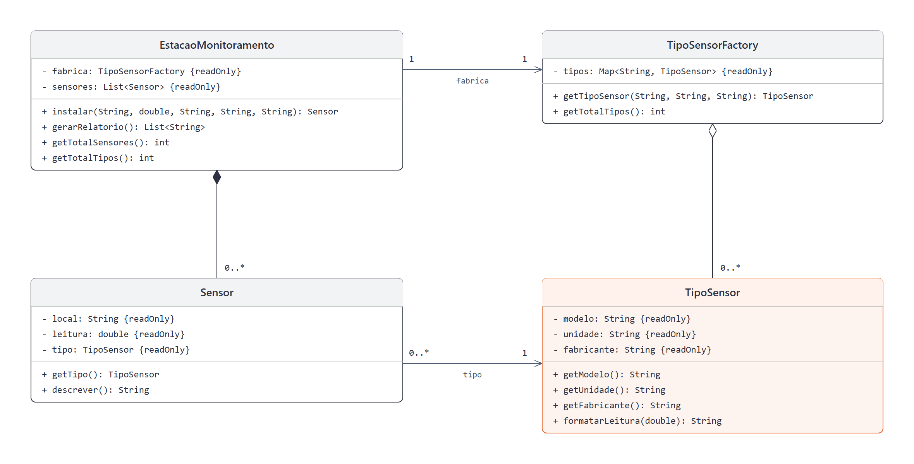

# DCC078 - Padrões de Projeto: Flyweight

**Aluno:** Felipe Lazzarini Cunha

## Tema

O projeto representa uma estação de monitoramento ambiental com muitos sensores instalados em locais diferentes. O Flyweight compartilha os dados comuns de cada tipo de sensor, como modelo, unidade e fabricante, enquanto cada sensor guarda apenas seu local e sua leitura.

## Diagrama de Classes UML



## Estrutura do Projeto

- `TipoSensor`: flyweight imutável com o estado intrínseco compartilhado.
- `TipoSensorFactory`: fábrica que reutiliza os tipos já criados.
- `Sensor`: objeto de contexto com o estado extrínseco (local e leitura).
- `EstacaoMonitoramento`: cliente que instala sensores e gera o relatório.

## Testes

Com JDK 11 ou superior e Maven:

```bash
mvn test
```
